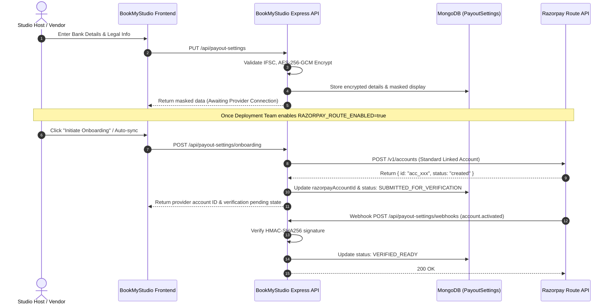

# Razorpay Route Integration & Deployment Handover Guide

**Project:** BookMyStudio  
**Target Module:** Vendor Payout Settings & Route Linked Accounts  
**Target Environment:** Local Development / Staging / Production  
**Status:** Application-Side Foundation Complete · Awaiting Provider Activation  

---

## 1. Application-Side Functionality Implemented

The local application-side foundation is complete, secure, and production-ready:

- **Frontend Settings UI (`/account/settings/payouts` & `/profile/settings/payouts`)**:
  - Unified `<SettingsNav />` between **Account & Security** and **Payout Settings**.
  - Real-time client-side and server-side validation for IFSC codes (`/^[A-Z]{4}0[A-Z0-9]{6}$/`), bank account number digits (9–18 chars, preserving leading zeros), and confirmation checks.
  - Entity-specific fields: Individual vs. Registered Business Entity (Legal Name, Business Type, GSTIN, PAN).
  - Masked bank account display (`••••••••${last4}`) with zero plain account numbers exposed in responses or DOM prefilling.
  - Modal confirmation prior to replacing active verified bank details.
  - Mobile-first responsive touch ergonomics (no iOS Safari viewport auto-zoom via `min-h-[44px] text-base sm:text-xs`).
  - Distinct lifecycle statuses: `Not Set Up`, `Details Incomplete`, `Details Saved`, `Awaiting Razorpay Route Connection`, `Verification Pending`, `Action Required`, `Verified / Ready`, and `Unavailable`.
- **Backend Data Layer & APIs (`/api/payout-settings`)**:
  - Authenticated session enforcement (`requireAuth`).
  - Strict 1:1 user-to-payout settings binding derived solely from server sessions (zero client IDOR).
  - AES-256-GCM authenticated encryption for sensitive bank account numbers with unique 16-byte random IVs and authentication tags.
  - Endpoints:
    - `GET /api/payout-settings`: Retrieves safe masked bank information and onboarding status.
    - `PUT /api/payout-settings`: Saves/updates bank information with AES-256-GCM encryption and audit history.
    - `POST /api/payout-settings/onboarding`: Clean provider initiation boundary returning honest `PROVIDER_NOT_CONFIGURED` when Route is inactive.
    - `GET /api/payout-settings/status`: Polls verified status from database and Razorpay.
    - `POST /api/payout-settings/webhooks`: Verified HMAC-SHA256 signature webhook receiver for Razorpay lifecycle events.

---

## 2. Required Environment Variable Names

Configure these variables in `server/.env` (and deployment environment settings). **Never commit real secrets to Git.**

| Variable Name | Environment | Description |
| :--- | :--- | :--- |
| `PAYOUT_ENCRYPTION_SECRET` | All | 32+ character random string used to derive the AES-256-GCM symmetric key for bank account number encryption. |
| `RAZORPAY_KEY_ID` | Test / Prod | Razorpay API Key ID (starts with `rzp_test_` in test mode or `rzp_live_` in production). |
| `RAZORPAY_KEY_SECRET` | Test / Prod | Razorpay API Secret associated with the Key ID. |
| `RAZORPAY_WEBHOOK_SECRET` | Test / Prod | Secret token configured in the Razorpay Dashboard to sign webhook payloads. |
| `RAZORPAY_ROUTE_ENABLED` | Test / Prod | Set to `true` once Razorpay has approved and activated Route on your merchant account. Default is `false`. |

---

## 3. Razorpay Route Activation Requirements

Before live onboarding or split settlements can function:

1. **Active Razorpay Merchant Account**: The business entity operating BookMyStudio must have a fully activated Indian Razorpay account with completed company KYC.
2. **Route Product Entitlement**:
   - Razorpay Route is an add-on product that requires approval from Razorpay risk and sales teams.
   - Go to **Razorpay Dashboard > Settings > Route** or contact your Razorpay account manager.
   - Request activation of **"Razorpay Route (Linked Accounts)"** for marketplace split payments.
3. **Marketplace Model Approval**:
   - Razorpay requires clarification of the platform model (two-sided creative studio/gear marketplace).
   - Expected transaction flows: Customer pays Platform $\rightarrow$ Platform takes marketplace fee $\rightarrow$ Remainder transferred to Host/Vendor linked account.

---

## 4. Required Merchant / Business Onboarding Steps

Once Route is activated by Razorpay:

1. **Dashboard Verification**: Ensure the "Route" tab appears in your Razorpay Dashboard with sub-menus for *Accounts*, *Transfers*, and *Settlements*.
2. **Nodal / Escrow Compliance**: Razorpay handles underlying nodal account compliance under RBI payment aggregator guidelines.
3. **Settlement Schedule**: Configure your standard settlement schedule (e.g., $T+1$ or $T+2$ business days following production wrap).

---

## 5. Supported Linked-Account Onboarding Flow

BookMyStudio implements the official **Standard Linked Accounts REST Flow**:
Reference: [Razorpay Route Linked Accounts Documentation](https://razorpay.com/docs/payments/route/linked-accounts/)

### Flow Diagram



---

## 6. How to Configure Test and Live Environments

### Test Mode (Sandbox)
1. In the Razorpay Dashboard, toggle the switch in the top header to **Test Mode**.
2. Generate API Keys: **Settings > API Keys > Generate Key**.
3. Set environment variables:
   ```env
   RAZORPAY_KEY_ID=rzp_test_xxxxxxxxxxxxxx
   RAZORPAY_KEY_SECRET=yyyyyyyyyyyyyyyyyyyyyyyy
   RAZORPAY_ROUTE_ENABLED=true
   RAZORPAY_WEBHOOK_SECRET=your_test_webhook_secret
   ```
4. Test linked-account creation directly against Razorpay's sandbox without real monetary movement.

### Live Mode (Production)
1. Toggle the header to **Live Mode**.
2. Generate live keys under **Settings > API Keys**.
3. Set production environment variables (via Docker, Kubernetes secrets, or cloud key vault):
   ```env
   RAZORPAY_KEY_ID=rzp_live_xxxxxxxxxxxxxx
   RAZORPAY_KEY_SECRET=zzzzzzzzzzzzzzzzzzzzzzzz
   RAZORPAY_ROUTE_ENABLED=true
   RAZORPAY_WEBHOOK_SECRET=your_production_webhook_secret
   ```

---

## 7. Webhook Configuration & Signature Verification

BookMyStudio includes an automated webhook endpoint at `/api/payout-settings/webhooks`.

### Setup in Razorpay Dashboard
1. Go to **Settings > Webhooks > Add New Webhook**.
2. Set the Webhook URL: `https://api.bookmystudio.com/api/payout-settings/webhooks`
3. Enter a strong random secret and copy it into `RAZORPAY_WEBHOOK_SECRET`.
4. Subscribe to the following **Account** events:
   - `account.activated` — Triggers `VERIFIED_READY` status.
   - `account.under_review` — Triggers `SUBMITTED_FOR_VERIFICATION` status.
   - `account.needs_clarification` — Triggers `ACTION_REQUIRED` status.
   - `account.rejected` — Triggers `UNAVAILABLE` status.
   - `account.suspended` — Triggers `UNAVAILABLE` status.

### Security Implementation
- Webhooks verify signatures using `crypto.createHmac('sha256', secret).update(rawPayload).digest('hex')` matched against the `X-Razorpay-Signature` header via constant-time comparison (`crypto.timingSafeEqual`).
- Requests with invalid signatures are rejected with HTTP 400.

---

## 8. How the Deployment Team Can Test Onboarding

1. Ensure MongoDB and the Express backend are running:
   ```bash
   pnpm --filter bookmystudio-server dev
   ```
2. In another terminal, run the Next.js frontend:
   ```bash
   pnpm dev
   ```
3. Log in with a host or customer account and navigate to `/account/settings/payouts`.
4. Enter test bank details:
   - Account Holder: `Apex Cinema Stages Pvt Ltd`
   - Account Number: `000123456789`
   - Confirm Number: `000123456789`
   - IFSC Code: `HDFC0000123`
   - Account Type: `Current`
5. Save the details. Verify that:
   - The UI displays: `Status: Awaiting Razorpay Route Connection`.
   - The account number is masked as `••••••••6789`.
   - Local database records contain encrypted data and zero plaintext account numbers.
6. To test live Route communication, supply valid test credentials (`rzp_test_...`), set `RAZORPAY_ROUTE_ENABLED=true`, and click "Check Status" or trigger `POST /api/payout-settings/onboarding`.

---

## 9. Responsibilities Matrix

| Action Item | Application Code (Done) | Deployment / Ops Team | Razorpay Action |
| :--- | :---: | :---: | :---: |
| UI & Bank Account Forms | ✅ | — | — |
| AES-256-GCM Sensitive Data Encryption | ✅ | — | — |
| Input Validation & Masking | ✅ | — | — |
| REST Endpoints & Webhook Controller | ✅ | — | — |
| Automated Integration Tests | ✅ | — | — |
| Merchant KYC & Account Approval | — | Submit docs | Approve |
| Route Activation on Merchant Account | — | Request Route | Enable Route |
| Generation of API & Webhook Keys | — | Generate | — |
| Injection of Secrets into Cloud Platform | — | Configure | — |

---

## 10. Remaining Steps Before Real Payments & Payouts Go Live

1. **Customer Checkout Integration**: Implement Razorpay Standard Checkout (`Razorpay()` JavaScript SDK) on booking confirmation.
2. **Transfer Logic & Fee Splitting**: Use `transfers` parameter during order payment capture or call `POST /v1/transfers` to disburse funds to `razorpayAccountId` minus the BookMyStudio platform commission (e.g., 10%).
3. **Escrow Holding Logic**: Configure auto-transfer hold until shoot completion or schedule transfers on wrap date.
4. **GST Invoicing**: Automate invoice generation for platform commission fees.

